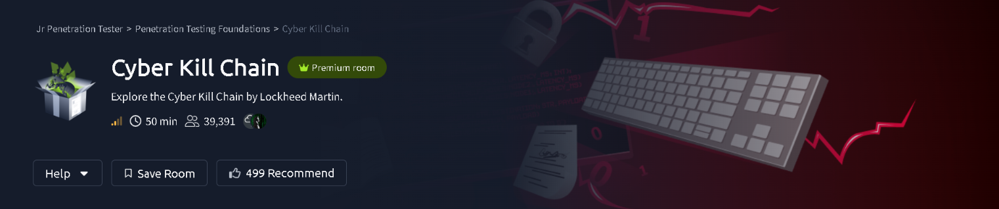
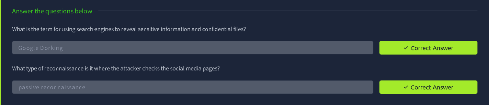
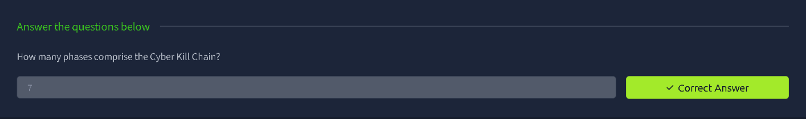
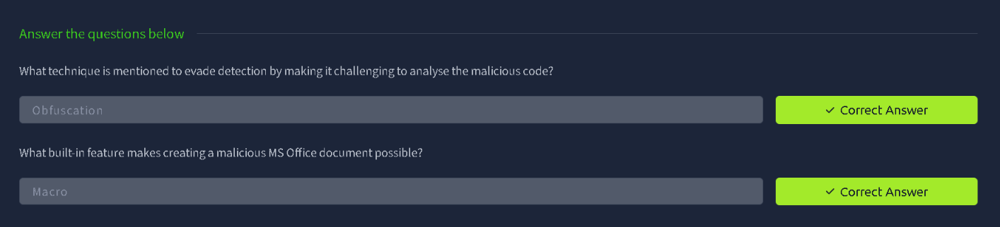
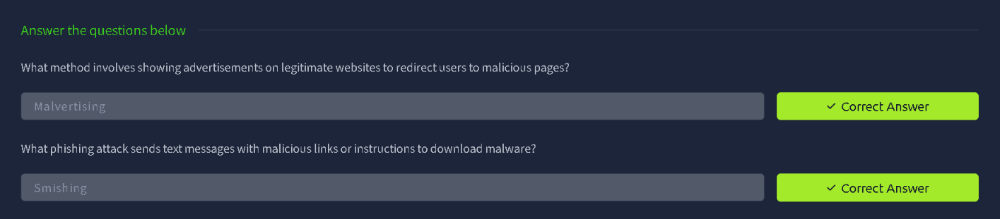
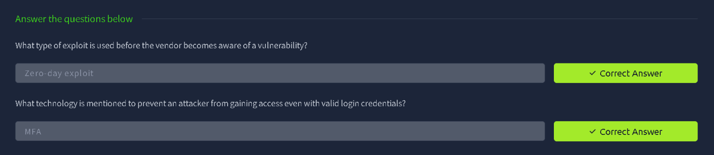
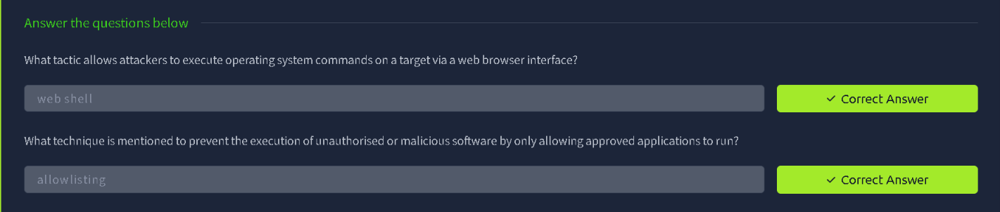
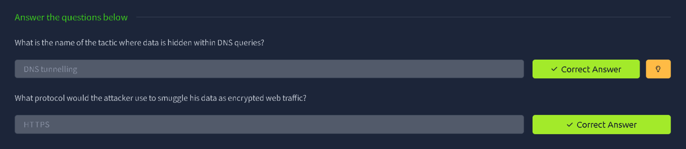
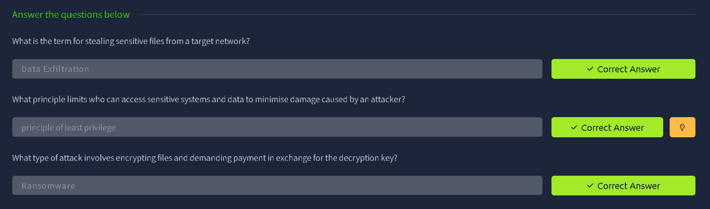
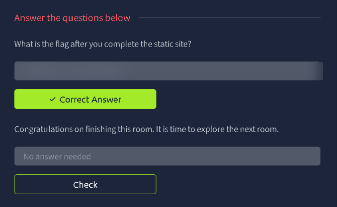

# Cyber Kill Chain — TryHackMe Walkthrough

**Room:** [Cyber Kill Chain](https://tryhackme.com/room/cyberkillchainzmt) · Jr Penetration Tester → Penetration Testing Foundations
**Type:** Conceptual room with a short interactive "static site" exercise for the flag
**Objective:** Understand the seven phases of Lockheed Martin's Cyber Kill Chain, the techniques attackers use in each phase, and the defensive controls that break the chain



The Cyber Kill Chain models an intrusion as a sequence of stages. The idea is that an attacker must succeed at *every* stage to reach their goal, so a defender only needs to disrupt *one*. This writeup walks through each phase, the answers from the room, and the reasoning behind them.

---

## 1. Reconnaissance

The attacker gathers information about the target before touching it.



| Question | Answer | Why |
|---|---|---|
| Term for using search engines to reveal sensitive information and confidential files | **Google Dorking** | Advanced search operators surface exposed files, login pages and misconfigurations that were indexed by accident |
| Type of recon where the attacker checks social media pages | **Passive reconnaissance** | No direct interaction with the target's systems; the data is already public (OSINT) |

---

## 2. The Seven Phases



| Question | Answer |
|---|---|
| How many phases comprise the Cyber Kill Chain? | **7** |

In order: **Reconnaissance → Weaponization → Delivery → Exploitation → Installation → Command & Control → Actions on Objectives.**

---

## 3. Weaponization

The attacker builds or prepares the malicious payload.



| Question | Answer | Why |
|---|---|---|
| Technique used to evade detection by making malicious code hard to analyse | **Obfuscation** | Scrambling or hiding code logic defeats signature matching and slows down analysts |
| Built-in feature that makes a malicious MS Office document possible | **Macro** | Macros run automated code inside Office files, so a weaponized document can execute a payload when opened |

---

## 4. Delivery

The payload is sent to the victim.



| Question | Answer | Why |
|---|---|---|
| Showing ads on legitimate websites to redirect users to malicious pages | **Malvertising** | Malicious advertising abuses trusted ad networks and sites |
| Phishing attack that sends text messages with malicious links | **Smishing** | SMS phishing |

---

## 5. Exploitation

The attacker triggers a weakness to run their code.



| Question | Answer | Why |
|---|---|---|
| Exploit used before the vendor becomes aware of a vulnerability | **Zero-day exploit** | No patch exists yet, so defenders have had "zero days" to fix it |
| Technology that prevents access even with valid login credentials | **MFA** | A stolen password alone isn't enough without the second factor |

---

## 6. Installation

The attacker establishes persistence on the compromised system.



| Question | Answer | Why |
|---|---|---|
| Tactic that lets attackers execute OS commands through a web browser interface | **Web shell** | A script planted on a web server provides remote command execution over HTTP |
| Technique that stops unauthorised or malicious software by only allowing approved applications to run | **Allowlisting** | Anything not explicitly approved is blocked by default, which also hinders dropped malware |

---

## 7. Command & Control (C2)

The compromised host calls back to the attacker for instructions, often disguised as normal traffic.



| Question | Answer | Why |
|---|---|---|
| Tactic where data is hidden within DNS queries | **DNS tunnelling** | DNS is rarely blocked, making it a convenient covert channel |
| Protocol used to smuggle data as encrypted web traffic | **HTTPS** | C2 traffic blends in with legitimate encrypted browsing |

---

## 8. Actions on Objectives

The attacker finally achieves their goal.



| Question | Answer | Why |
|---|---|---|
| Term for stealing sensitive files from a target network | **Data exfiltration** | Data is copied out of the environment |
| Principle that limits who can access sensitive systems and data to minimise damage | **Principle of least privilege** | Accounts get only the access they need, shrinking the blast radius of a compromise |
| Attack that encrypts files and demands payment for the decryption key | **Ransomware** | Extortion through encryption |

---

## 9. Final Task — Flag

The final task has you work through the interactive static site, mapping attack steps to their kill chain phases, and the completed site reveals the flag.



```
THM{████████████████}
```

*(Flag redacted — complete the static site in the room to obtain it.)*

---

## Summary

| Phase | What the attacker does | Example from the room | Defensive control |
|---|---|---|---|
| Reconnaissance | Gather target info | Google Dorking, social media (passive) | Limit public exposure |
| Weaponization | Build the payload | Obfuscation, Office macros | Disable macros, email filtering |
| Delivery | Get it to the victim | Malvertising, smishing | User awareness, web filtering |
| Exploitation | Trigger a flaw | Zero-day exploit | Patching, MFA |
| Installation | Persist | Web shell | Application allowlisting |
| C2 | Remote control | DNS tunnelling, HTTPS | Egress and DNS monitoring |
| Actions on Objectives | Achieve the goal | Exfiltration, ransomware | Least privilege, backups |

**Key takeaway:** breaking the chain at *any* link stops the intrusion, so layered defences at several phases are far more resilient than relying on a single control.

---
*Room: [TryHackMe — Cyber Kill Chain](https://tryhackme.com/room/cyberkillchainzmt)*
